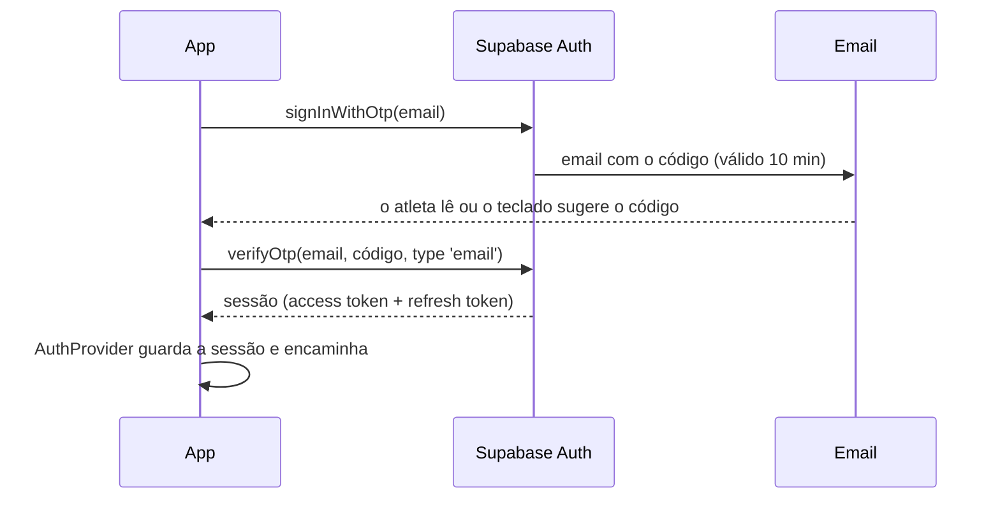

# Login no Treker

Como funciona o login por código, onde fica a sessão e como testar em desenvolvimento.

## Como funciona

O atleta entra sem password, com um **código de 6 dígitos** enviado por email.



1. **Ecrã de email** (`/sign-in`): valida o email (Zod, em [`src/core/auth`](../src/core/auth/)) e pede o código.
2. **Ecrã do código** (`/verify`):
   - Teclado numérico com sugestão automática do código (`oneTimeCode` no iOS, `sms-otp` no Android). Ao 6.º dígito o código é enviado sozinho.
   - "Enviar novo código" fica bloqueado durante 60 s, com contagem decrescente.
   - "Usar outro email" volta ao ecrã anterior.
3. **Onboarding** (`/onboarding`), só da primeira vez:
   - O atleta indica o nome, a unidade de peso (kg/lb), a unidade da piscina (m/yd) e, se quiser, o peso corporal.
   - A língua e o fuso horário vêm do telemóvel.
   - Tudo é gravado em `profiles`, e `onboarded_at` marca o onboarding como feito.
4. **App** (`/`).

### Regras

| Regra | Valor | Onde |
| --- | --- | --- |
| Tamanho do código | 6 dígitos | `supabase/config.toml` (`otp_length`) |
| Validade | 10 minutos | `otp_expiry = 600` |
| Espera entre envios | 60 s | `max_frequency = "60s"` e `RESEND_COOLDOWN_SECONDS` em `src/core/auth` |
| Contas novas | Criadas automaticamente no primeiro código | `shouldCreateUser: true` |

**Não revela se um email tem conta.** Um email novo recebe o mesmo código e a mesma resposta que um email já registado: a conta é criada nesse momento.

### Mensagens de erro

Todas traduzidas (en/pt), em `auth.errors` nos dicionários.

| Situação | Mensagem |
| --- | --- |
| Código errado | "Código incorreto…" |
| Código expirado | "Este código expirou…" |
| Demasiados pedidos ou tentativas (HTTP 429) | "Demasiadas tentativas…" |
| Sem rede | "Sem ligação…" |
| Outro erro | "Algo correu mal…" |

O Supabase responde da mesma forma (`otp_expired`) a um código errado e a um código expirado. A app distingue-os pelo tempo: se ainda não passaram 10 minutos desde o envio, é um código errado. A lógica está em `classifyVerifyError`, com testes.

## Navegação

As rotas estão em três grupos, protegidos com `Stack.Protected` (a forma recomendada pelo Expo Router), em [`src/features/auth/root-navigator.tsx`](../src/features/auth/root-navigator.tsx):

| Situação | Grupo disponível | Ecrãs |
| --- | --- | --- |
| Sem sessão | `(auth)` | `/sign-in`, `/verify` |
| Com sessão, sem onboarding | `(onboarding)` | `/onboarding` |
| Com sessão e onboarding feito | `(app)` | `/`, … |

Quando a sessão ou o perfil mudam, o router leva o atleta para o grupo certo (`redirectTo`). O ecrã de arranque (splash) fica visível até as fontes e a sessão guardada estarem carregadas, para o login nunca aparecer por instantes antes da app.

Isto só decide a navegação. **Os dados estão protegidos no Postgres** (RLS), não pelas rotas.

## Onde fica a sessão

- O [`AuthProvider`](../src/features/auth/auth-provider.tsx) guarda em memória a sessão e o perfil, e ouve o `onAuthStateChange` do Supabase.
- A sessão persistente fica cifrada ([`secure-session-storage.ts`](../src/lib/supabase/secure-session-storage.ts)), como recomenda o guia do Supabase para Expo:
  - uma chave AES-256 aleatória é guardada no **SecureStore** (Keychain no iOS, Keystore no Android);
  - a sessão é cifrada com essa chave, e só o texto cifrado vai para o AsyncStorage;
  - sem a chave, o que está no AsyncStorage não se consegue ler.

  É assim porque uma sessão do Supabase pode ser maior do que o que o Keychain aceita com segurança num só item (cerca de 2 KB).
- **Renovação do token:** o token é renovado automaticamente só com a app em primeiro plano. O `AppState` para a renovação em segundo plano e retoma-a quando a app volta.
- **Terminar sessão** apaga a sessão deste telemóvel, mesmo sem rede.

**Limitação até ao passo 6 (offline):** se o perfil não carregar (por exemplo, sem rede), o atleta entra na app e o onboarding volta a ser verificado no arranque seguinte.

## Configuração

As variáveis ficam num `.env` na raiz, que não vai para o git. Copia o [`.env.example`](../.env.example):

```bash
EXPO_PUBLIC_SUPABASE_URL=http://192.168.1.69:54321
EXPO_PUBLIC_SUPABASE_ANON_KEY=sb_publishable_...
```

- **A chave é a pública.** Usa o `PUBLISHABLE_KEY` de `npx supabase status`, o novo nome da chave anon. Tudo o que está em variáveis `EXPO_PUBLIC_` vai dentro da app, por isso **nunca** se põe aqui a chave secreta nem a `service_role`.
- **O URL usa o IP do PC na rede local**, não `127.0.0.1`. No telemóvel, `127.0.0.1` é o próprio telemóvel.

### Descobrir o IP do PC no Windows

Numa janela de PowerShell:

```powershell
ipconfig
```

Procura o adaptador **Wi-Fi** (ou Ethernet, se o PC estiver ligado por cabo). O valor é o de **Endereço IPv4** / **IPv4 Address**, por exemplo `192.168.1.69`.

Ou diretamente:

```powershell
Get-NetIPConfiguration | Where-Object IPv4DefaultGateway | Select-Object InterfaceAlias, IPv4Address
```

O IP pode mudar quando mudas de rede ou o router reinicia. Se o login deixar de funcionar, confirma o IP e atualiza o `.env`, e depois reinicia o `npx expo start`: as variáveis `EXPO_PUBLIC_` são lidas no arranque.

## Ler os códigos em desenvolvimento

O Supabase local não envia emails a sério. Guarda-os no **Mailpit**:

- Abre http://127.0.0.1:54324 no browser do PC.
- Cada pedido de código aparece lá, com o código em destaque.

Os templates dos emails estão em [`supabase/templates/sign-in-code.html`](../supabase/templates/sign-in-code.html), em inglês e português. Servem tanto para contas novas (`confirmation`) como para contas que já existem (`magic_link`).

Em produção (passo 4b) é preciso um serviço de email a sério (SMTP) e os mesmos templates configurados no projeto online.

## Testes

- `src/core/auth/auth.test.ts`: validação do email e do código, tempo de espera para reenviar, e classificação de erros.
- `src/core/profile/onboarding.test.ts`: validação do onboarding e conversão de lb para kg.
- `__tests__/auth/`: ecrãs com o Supabase simulado ([`test-utils/supabase-mock.ts`](../test-utils/supabase-mock.ts)):
  - código errado, sem rede e formato inválido;
  - reenviar bloqueado durante 60 s;
  - encaminhamento para o onboarding ou para a app;
  - terminar sessão.
