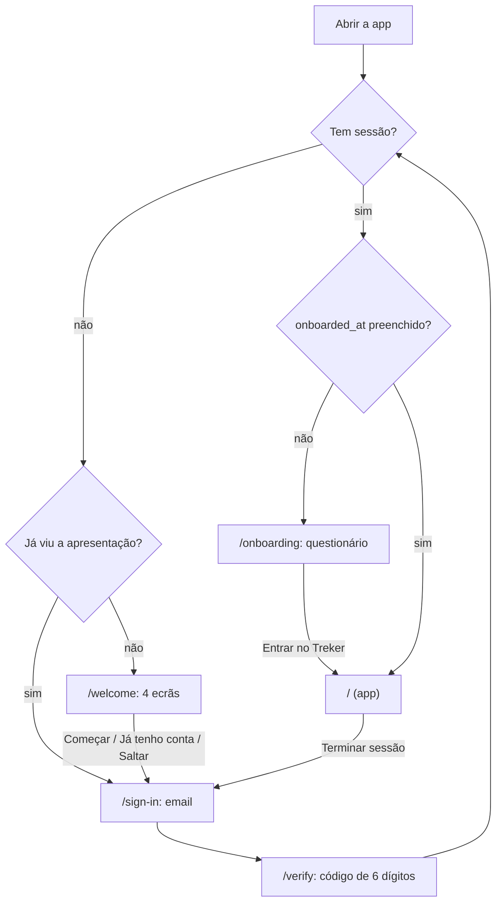
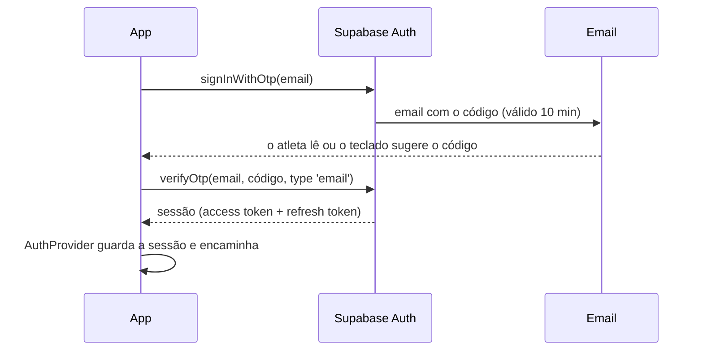

# Login e onboarding no Treker

Como funcionam a apresentação, o login por código e o questionário inicial, onde fica a sessão e como testar em desenvolvimento.

## Fluxo completo



### 1. Apresentação (`/welcome`)

Quatro ecrãs que se passam a deslizar, ou com "Seguinte" para quem não consegue deslizar (por exemplo, com um leitor de ecrã). Têm indicador de página e "Saltar" sempre visível. Cada ilustração é feita com os componentes da app ([`src/features/intro/illustrations.tsx`](../src/features/intro/illustrations.tsx)).

- **Só aparece na primeira vez.** Depois de terminar (por qualquer botão), o telemóvel guarda `treker.intro-seen` e, mesmo depois de terminar sessão, a app abre no ecrã do email.
- **Reduzir movimento:** com a opção do sistema ligada, o botão "Seguinte" muda de página sem animação.
- **"Começar" e "Já tenho conta"** levam os dois ao ecrã do email, porque o login por código cria a conta quando é preciso; só muda o título ("Cria a tua conta" ou "Entrar").

### 2. Login por código

O atleta entra sem password, com um **código de 6 dígitos** enviado por email.



1. **Ecrã de email** (`/sign-in`): valida o email (Zod, em [`src/core/auth`](../src/core/auth/)) e pede o código.
2. **Ecrã do código** (`/verify`):
   - Teclado numérico com sugestão automática do código (`oneTimeCode` no iOS, `sms-otp` no Android). Ao 6.º dígito o código é enviado sozinho.
   - "Enviar novo código" fica bloqueado durante 60 s, com contagem decrescente.
   - "Usar outro email" volta ao ecrã anterior.
#### Regras do código

| Regra | Valor | Onde |
| --- | --- | --- |
| Tamanho do código | 6 dígitos | `supabase/config.toml` (`otp_length`) |
| Validade | 10 minutos | `otp_expiry = 600` |
| Espera entre envios | 60 s | `max_frequency = "60s"` e `RESEND_COOLDOWN_SECONDS` em `src/core/auth` |
| Contas novas | Criadas automaticamente no primeiro código | `shouldCreateUser: true` |

**Não revela se um email tem conta.** Um email novo recebe o mesmo código e a mesma resposta que um email já registado: a conta é criada nesse momento.

#### Mensagens de erro

Todas traduzidas (en/pt), em `auth.errors` nos dicionários.

| Situação | Mensagem |
| --- | --- |
| Código errado | "Código incorreto…" |
| Código expirado | "Este código expirou…" |
| Demasiados pedidos ou tentativas (HTTP 429) | "Demasiadas tentativas…" |
| Sem rede | "Sem ligação…" |
| Outro erro | "Algo correu mal…" |

O Supabase responde da mesma forma (`otp_expired`) a um código errado e a um código expirado. A app distingue-os pelo tempo: se ainda não passaram 10 minutos desde o envio, é um código errado. A lógica está em `classifyVerifyError`, com testes.

### 3. Questionário (`/onboarding`)

Só depois do primeiro login, enquanto `profiles.onboarded_at` estiver vazio. Mostra uma pergunta por ecrã, com barra de progresso, "Voltar" (também o botão de recuo do Android) e opções grandes. **Cada pergunta muda alguma coisa na app**: não se pergunta idade, sexo, altura nem nível de experiência.

| # | Pergunta | Quando aparece | Grava em | Para quê |
| --- | --- | --- | --- | --- |
| 1 | Nome | Sempre | `display_name` | Saudação e perfil |
| 2 | Modalidades (Ginásio, Natação; pelo menos uma) | Sempre | `sports` | Ecrã inicial e perguntas seguintes |
| 3 | Foco no ginásio: força, massa muscular ou manter a forma | Com ginásio | `gym_focus` | O que o ecrã inicial destaca: recordes e 1RM, volume por grupo muscular, ou consistência |
| 4 | Competes ou treinas sem competir | Com natação | `swim_style` | Tempos de prova e recordes por prova, ou distância e regularidade |
| 5 | Piscina habitual: 25 m, 50 m ou 25 jardas | Com natação | `default_pool_length`, `pool_unit` | Pré-selecionada ao registar um tempo |
| 6 | Treinos por semana (1 a 14, todas as modalidades) | Sempre | `weekly_target` | Objetivo semanal |
| 7 | Unidade de peso e peso corporal (opcional) | Sempre | `weight_unit`, `bodyweight_kg` | Unidades e 1RM das elevações e dips |
| 8 | Resumo e "Entrar no Treker" | Sempre | — | — |

- **Valores por defeito:** kg e 25 m; lb e 25 jardas só se a região do telemóvel for os EUA. A língua e o fuso horário vêm do telemóvel.
- **Lógica fora dos ecrãs:** que perguntas aparecem, a ordem, a validação de cada resposta, a retoma e o que se grava estão em [`src/core/onboarding`](../src/core/onboarding/), com testes.
- **Retoma:** cada resposta é guardada no telemóvel (`treker.onboarding-draft.<id do utilizador>`). Se a app fechar a meio, o questionário continua na mesma pergunta. Se uma resposta anterior faltar, continua na primeira pergunta por responder.
- **Gravação:** no fim, grava tudo de uma vez em `profiles`, incluindo `onboarded_at`. O Postgres confirma que as respostas estão completas (`profiles_onboarding_complete`). Se falhar (por exemplo, sem rede), mostra o erro e deixa tentar outra vez, sem perder nada. Só depois de gravar é que o rascunho é apagado.
- **Ecrã inicial provisório:** mostra o nome e o resumo das escolhas. As respostas vão decidir o ecrã inicial verdadeiro (ver a nota em [plano-produto.md](plano-produto.md)).

## Navegação

As rotas estão em três grupos, protegidos com `Stack.Protected` (a forma recomendada pelo Expo Router), em [`src/features/auth/root-navigator.tsx`](../src/features/auth/root-navigator.tsx):

| Situação | Grupo disponível | Ecrãs |
| --- | --- | --- |
| Sem sessão | `(auth)` | `/welcome` (só da primeira vez), `/sign-in`, `/verify` |
| Com sessão, sem onboarding | `(onboarding)` | `/onboarding` |
| Com sessão e onboarding feito | `(app)` | `/`, … |

Quando a sessão ou o perfil mudam, o router leva o atleta para o grupo certo (`redirectTo`). **Só conta como "com sessão" depois de o perfil chegar**: logo a seguir ao código, a sessão chega antes do perfil. Se a app abrisse nesse intervalo, os seus ecrãs montavam e desmontavam logo a seguir para quem ainda precisa do onboarding, e isso deixava ações de navegação sem destino (o erro "ROUTE_NAMES_CHANGED … was not handled"). Até o perfil chegar, o atleta fica no ecrã do código; no arranque, o splash cobre esse tempo.

Dentro da app, os ecrãs principais (Hoje, Calendário, Recordes e Perfil) estão num menu lateral (Drawer do Expo Router), em [`src/app/(app)/(drawer)/_layout.tsx`](../src/app/(app)/(drawer)/_layout.tsx):
- abre com o botão de menu no cabeçalho ou a deslizar a partir da borda esquerda;
- o item ativo fica destacado com a cor de acento;
- no topo tem o logótipo, o nome e o objetivo semanal, e no fundo a versão.

Começar um treino é o botão flutuante "+", no canto inferior direito de cada ecrã principal. Abre `/start` em modal, só com as modalidades escolhidas.

A lista de ecrãs de cada navegador é sempre a mesma; o perfil muda o que eles mostram, nunca que rotas existem. A exceção são os três grupos de topo, que o `Stack.Protected` abre e fecha de propósito. O ecrã de arranque (splash) fica visível até as fontes, a sessão guardada e a indicação de que a apresentação já foi vista estarem carregadas, para nunca aparecer por instantes o ecrã errado.

Isto só decide a navegação. **Os dados estão protegidos no Postgres** (RLS), não pelas rotas.

## Onde fica a sessão

- O [`AuthProvider`](../src/features/auth/auth-provider.tsx) guarda em memória a sessão e o perfil, e ouve o `onAuthStateChange` do Supabase.
- A sessão persistente fica cifrada ([`secure-session-storage.ts`](../src/lib/supabase/secure-session-storage.ts)), como recomenda o guia do Supabase para Expo:
  - uma chave AES-256 aleatória é guardada no **SecureStore** (Keychain no iOS, Keystore no Android);
  - a sessão é cifrada com essa chave, e só o texto cifrado vai para o AsyncStorage;
  - sem a chave, o que está no AsyncStorage não se consegue ler.

  É assim porque uma sessão do Supabase pode ser maior do que o que o Keychain aceita com segurança num só item (cerca de 2 KB).
- **Renovação do token:** o token é renovado automaticamente só com a app em primeiro plano. O `AppState` para a renovação em segundo plano e retoma-a quando a app volta.
- **Terminar sessão** apaga a sessão deste telemóvel, mesmo sem rede.

**Limitação até ao passo 6 (offline):** se o perfil não carregar (por exemplo, sem rede), o atleta entra na app e o onboarding volta a ser verificado no arranque seguinte.

## Perfil: editar respostas e língua

- No ecrã **Perfil** (no menu lateral), cada resposta do questionário abre a mesma pergunta (`/settings/edit?step=…`), com a mesma validação de [`src/core/onboarding`](../src/core/onboarding/).
- **Acrescentar uma modalidade** faz as perguntas dela antes de gravar. Por exemplo, acrescentar natação pergunta o estilo e a piscina. Assim o perfil cumpre sempre as regras de consistência do Postgres. Retirar uma modalidade apaga as respostas dela.
- **Língua da app** (`/settings/language`): automática (a do telemóvel), inglês ou português. Fica guardada no telemóvel (`treker.language`) e aplica-se logo.
- **Ligações de apoio** ("Política de privacidade" e "Contactar"): os endereços estão num só sítio, [`src/lib/links.ts`](../src/lib/links.ts), e **ainda são provisórios**.

## Apagar conta

No Perfil, "Apagar conta" abre um ecrã (`/settings/delete-account`) que:

1. Explica o que se perde, para sempre: treinos, séries e tempos; recordes e estatísticas; o perfil, os objetivos e os exercícios personalizados.
2. Pede para escrever **APAGAR** (ou **DELETE** em inglês). O botão só fica ativo com a palavra certa, sem contar maiúsculas nem espaços à volta. A regra é `isDeleteConfirmed` em [`src/core/account`](../src/core/account/), com testes.
3. Chama a função Postgres `delete_my_account()` (ver [database.md](database.md#apagar-conta)). Ela apaga o utilizador de `auth.uid()` e, por cascata, todos os dados dele.
4. Esquece a sessão neste telemóvel, e o router leva ao ecrã do email.

Se não houver rede, a conta **não** é apagada: aparece o erro e o atleta pode tentar outra vez.

## Configuração

As variáveis ficam num `.env` na raiz, que não vai para o git. Copia o [`.env.example`](../.env.example):

```bash
EXPO_PUBLIC_SUPABASE_URL=http://192.168.1.69:54321
EXPO_PUBLIC_SUPABASE_PUBLISHABLE_KEY=sb_publishable_...
```

- **A chave é a pública.** Usa o `PUBLISHABLE_KEY` de `npx supabase status`, o novo nome da chave anon. Tudo o que está em variáveis `EXPO_PUBLIC_` vai dentro da app, por isso **nunca** se põe aqui a chave secreta nem a `service_role`.
- **O URL usa o IP do PC na rede local**, não `127.0.0.1`. No telemóvel, `127.0.0.1` é o próprio telemóvel.

### Descobrir o IP do PC no Windows

Numa janela de PowerShell:

```powershell
ipconfig
```

Procura o adaptador **Wi-Fi** (ou Ethernet, se o PC estiver ligado por cabo). O valor é o de **Endereço IPv4** / **IPv4 Address**, por exemplo `192.168.1.69`.

Ou diretamente:

```powershell
Get-NetIPConfiguration | Where-Object IPv4DefaultGateway | Select-Object InterfaceAlias, IPv4Address
```

O IP pode mudar quando mudas de rede ou o router reinicia. Se o login deixar de funcionar, confirma o IP e atualiza o `.env`, e depois reinicia o `npx expo start`: as variáveis `EXPO_PUBLIC_` são lidas no arranque.

## Ler os códigos em desenvolvimento

O Supabase local não envia emails a sério. Guarda-os no **Mailpit**:

- Abre http://127.0.0.1:54324 no browser do PC.
- Cada pedido de código aparece lá, com o código em destaque.

Os templates dos emails estão em [`supabase/templates/sign-in-code.html`](../supabase/templates/sign-in-code.html), em inglês e português. Servem tanto para contas novas (`confirmation`) como para contas que já existem (`magic_link`).

Em produção (passo 4b) é preciso um serviço de email a sério (SMTP) e os mesmos templates configurados no projeto online.

## Testes

- `src/core/auth/auth.test.ts`: validação do email e do código, tempo de espera para reenviar, e classificação de erros.
- `src/core/onboarding/onboarding.test.ts`:
  - as perguntas condicionais (só ginásio, só natação, as duas), a ordem e o progresso;
  - a validação de cada resposta e os valores por defeito (EUA ou não);
  - a retoma de um rascunho e o que se grava no perfil.
- `src/core/units/units.test.ts`: números com vírgula ou ponto e conversão entre kg e lb.
- Ecrãs com o Supabase simulado ([`test-utils/supabase-mock.ts`](../test-utils/supabase-mock.ts)) e as rotas reais ([`test-utils/render-app.tsx`](../test-utils/render-app.tsx)):
  - `__tests__/auth/`: código errado, sem rede e formato inválido; reenviar bloqueado durante 60 s; encaminhamento (apresentação, email, questionário, app); terminar sessão.
  - `__tests__/intro/`: indicador de página, "Saltar", os dois botões finais, e reduzir movimento.
  - `__tests__/onboarding/`: perguntas condicionais, resposta em falta, retoma a meio, o ecrã final, a gravação de uma só vez e a falha de rede.
  - `__tests__/app/`: o menu lateral (itens, item ativo, botão de menu em cada ecrã principal) e os estados vazios; o botão flutuante "+" só com as modalidades escolhidas; a navegação não abre a app antes de o perfil chegar; editar o perfil (validação, acrescentar e retirar modalidades); a língua; e apagar conta (a confirmação escrita antes de chamar a função, e a falha de rede).
- `supabase/tests/12_profile_onboarding.sql`: as regras de consistência das respostas e as permissões.
- `supabase/tests/13_delete_account.sql`: apagar a própria conta e todos os dados, sem tocar nos outros utilizadores; o anónimo não pode chamar a função.

## Ver a apresentação outra vez (desenvolvimento)

No ecrã do email há um botão **"Replay intro (dev)"**, que só existe em desenvolvimento. Termina sessão, carrega nesse botão, e a app volta à apresentação como se fosse a primeira vez.
