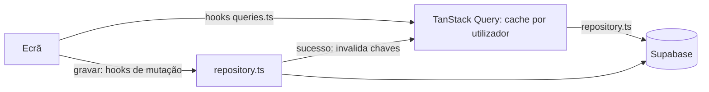

# Acesso a dados

Como a app lê e grava os dados do atleta. Por agora **a app funciona só com rede**: os dados vivem no Supabase, e o telemóvel guarda apenas uma cache em memória (TanStack Query). O offline foi adiado (fora da v1); ver [Voltar ao offline](#voltar-ao-offline).



## Três camadas

| Camada | Onde | Faz |
| --- | --- | --- |
| **Ecrãs** | `src/app/` | Mostram dados e chamam os hooks. **Nunca** chamam o Supabase |
| **Hooks** | `src/features/*/queries.ts` | Leituras (`useQuery`) e gravações (`useMutation`), com as chaves de cache e as invalidações |
| **Repositórios** | `src/features/*/repository.ts` | **O único sítio que chama o Supabase para dados do atleta.** Uma função por operação |

Fora dos repositórios, só o login (`src/features/auth/api.ts`) fala com o Supabase.

### Repositórios

| Repositório | Operações |
| --- | --- |
| `activities` | Começar, terminar, editar e apagar uma atividade; ler uma atividade com as séries e os tempos; listar e contar atividades por intervalo de datas |
| `gym` | Acrescentar, editar, apagar e listar séries |
| `swim` | Acrescentar, editar e apagar tempos de natação |
| `exercises` | Criar e procurar exercícios personalizados |
| `profile` | Ler e editar o perfil, concluir o onboarding, apagar a conta |

Recebem um `DataContext` (`src/lib/data/context.ts`): o id do atleta, o relógio e o gerador de ids. Nos testes, o relógio e os ids são fixos.

Regras:

- **Os ids são gerados no telemóvel**, e criar faz `upsert` por id. Repetir um pedido depois de uma falha de rede nunca duplica uma linha, desde que se use o mesmo id. As funções de criação aceitam um `id` opcional para isso; os hooks geram-no **antes** do pedido e "Tentar outra vez" repete-o com o mesmo.
- **Editar e apagar atualizam por id.** Apagar é marcar `deleted_at`, como no servidor. Apagar uma atividade é **um só pedido**, à função Postgres `delete_activity` ([database.md](database.md#apagar-uma-atividade)). Numa transação, marca a atividade, as séries e os tempos e reconstrói os recordes uma vez por chave; repetir não tem efeitos.
- **O servidor valida tudo** (RLS, chaves estrangeiras, regras de consistência, `created_at` e `updated_at`); ver [database.md](database.md). Os repositórios não repetem essas regras: as validações para dar feedback rápido estão em `src/core`.
- **Erros:** o supabase-js responde com `{ data, error }`, e os repositórios transformam isso em valor ou exceção (`src/lib/data/result.ts`).

## TanStack Query

Versão 5 (`@tanstack/react-query`), compatível com o React 19 do SDK 58. O cliente é criado em [`src/lib/data/query-client.ts`](../src/lib/data/query-client.ts).

### Chaves de cache

[`src/lib/data/query-keys.ts`](../src/lib/data/query-keys.ts): começam sempre pelo utilizador e depois pela entidade.

| Chave | Usada por |
| --- | --- |
| `['user', id, 'profile']` | O perfil (`AuthProvider`) |
| `['user', id, 'activities', 'count', início, fim]` | Treinos desta semana ("Hoje" e menu) |
| `['user', id, 'activities', 'list', início, fim]` | Listas por datas (calendário) |
| `['user', id, 'activities', 'detail', atividade]` | Uma atividade com as séries e os tempos |

### Regras de cache

- **Depois de cada gravação, invalidam-se as consultas afetadas.**
  - Qualquer escrita de treino (atividade, série ou tempo) passa por `useTrainingMutation` e invalida `['user', id, 'activities']`, que inclui listas, contagens e detalhes. Por exemplo, começar uma atividade atualiza o "Hoje".
  - Gravar o perfil substitui o perfil em cache pela linha devolvida pelo servidor (`useUpdateProfile`, `useCompleteOnboarding`), por isso a navegação reage logo.
- **Terminar sessão, apagar a conta ou a sessão expirar limpam a cache toda** (`queryClient.clear()` no `SIGNED_OUT`), para a próxima conta no mesmo telemóvel nunca ver dados da anterior.
- **Os dados ficam "frescos" 30 s.** Depois disso voltam a ser pedidos quando a app regressa a primeiro plano (`AppState`) ou quando a rede volta (NetInfo), como recomenda a documentação do TanStack Query para React Native.
- **Os pedidos correm mesmo quando o telemóvel diz que não tem rede** (`networkMode: 'always'`). Assim falham depressa com um erro claro, em vez de ficarem à espera em silêncio.
- **Novas tentativas:** as leituras tentam mais uma vez em erros de rede, e os erros do servidor não se repetem. As gravações não são repetidas sozinhas: quem as repete é o atleta, com "Tentar outra vez".

## Sem rede

- **Faixa "Sem ligação":** aparece no topo enquanto o NetInfo diz que não há rede (`src/features/network/offline-banner.tsx`). É discreta, não bloqueia toques e é anunciada pelo leitor de ecrã.
- **Erros traduzidos:** `classifyRequestError` (`src/core/errors`) separa a falta de rede dos outros erros, e o `ErrorNotice` mostra a mensagem com **"Tentar outra vez"**.
- **O que o atleta escreveu não se perde:** o formulário mantém o seu estado, e repetir usa os mesmos dados (e o mesmo id).
- **Onboarding:** o rascunho fica guardado no telemóvel (AsyncStorage) enquanto o atleta responde. Se a gravação final falhar, mostra o erro e deixa tentar outra vez; o rascunho só é apagado depois de gravar.
- **Perfil no arranque:** se não carregar, o atleta entra na app e o perfil volta a ser pedido quando a rede regressar.

## Voltar ao offline

Os ecrãs não sabem de onde vêm os dados: só usam os hooks, e os hooks só usam os repositórios. Para voltar a funcionar sem rede, **basta trocar a implementação dos repositórios**: ler e gravar numa base local e enviar as alterações por uma fila. As assinaturas mantêm-se, e os hooks passam a ler da base local.

Essa versão já existiu e está no histórico do git, no commit do passo 6a:

```
39415ab feat(offline): local SQLite database and outbox
```

Inclui:
- o SQLite com Drizzle e as migrações numeradas;
- o schema local verificado contra os tipos do servidor;
- a outbox, com uma entrada por linha e a ordem por dependências;
- os repositórios locais e o hook reativo;
- os testes sobre o SQLite do Node, e o documento `docs/offline.md`.

O que faltava nessa versão (o envio e a receção de dados do servidor) está descrito nesse documento.

Antes disso, a Fase 1 guarda o **treino em curso num rascunho no telemóvel** até ser gravado, para uma falha de rede no fim não perder as séries (nota no [plano-produto.md](plano-produto.md)).

## Testes

- `__tests__/data/repositories-test.ts`: os repositórios contra o Supabase simulado ([`test-utils/supabase-mock.ts`](../test-utils/supabase-mock.ts), uma base em memória). Inclui: repetir uma criação com o mesmo id não duplica; apagar marca `deleted_at` (também em cascata); contagens e listas por datas; erros de rede.
- `__tests__/app/today-test.tsx`: a contagem semanal do "Hoje", o erro com "Tentar outra vez", e uma gravação de treino a atualizar a contagem.
- `__tests__/app/network-test.tsx`: a faixa "Sem ligação" e a cache limpa ao terminar sessão.
- `__tests__/app/profile-test.tsx` e `__tests__/onboarding/questionnaire-test.tsx`: as gravações no servidor, e o erro de rede com "Tentar outra vez" sem perder o formulário nem o rascunho.

Nos testes, o TanStack Query não repete pedidos e entrega as atualizações numa microtask (`jest.setup.ts`), para os ecrãs se atualizarem dentro do `act`.
