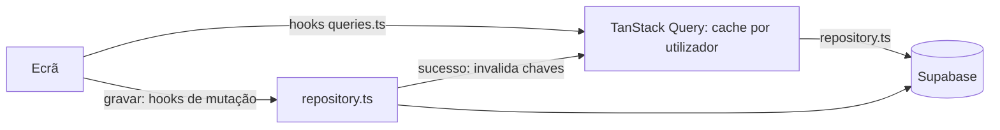
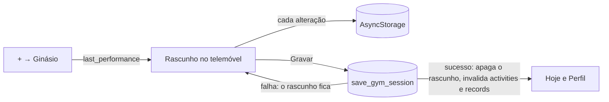

# Acesso a dados

Como a app lê e grava os dados do atleta. Por agora **a app funciona só com rede**: os dados vivem no Supabase, e o telemóvel guarda apenas uma cache em memória (TanStack Query). O offline foi adiado (fora da v1); ver [Voltar ao offline](#voltar-ao-offline).



## Três camadas

| Camada | Onde | Faz |
| --- | --- | --- |
| **Ecrãs** | `src/app/` | Mostram dados e chamam os hooks. **Nunca** chamam o Supabase |
| **Hooks** | `src/features/*/queries.ts` | Leituras (`useQuery`) e gravações (`useMutation`), com as chaves de cache e as invalidações |
| **Repositórios** | `src/features/*/repository.ts` | **O único sítio que chama o Supabase para dados do atleta.** Uma função por operação |

Fora dos repositórios, só o login (`src/features/auth/api.ts`) fala com o Supabase.

### Repositórios

| Repositório | Operações |
| --- | --- |
| `activities` | Começar, terminar, editar e apagar uma atividade; ler uma atividade com as séries e os tempos e os seus recordes; listar e contar atividades por intervalo de datas; listar os treinos com os totais, por páginas (`list_activity_summaries`) |
| `gym` | Acrescentar, editar, apagar e listar séries |
| `swim` | Acrescentar, editar e apagar tempos de natação |
| `exercises` | Listar a biblioteca e os exercícios próprios; criar, editar, eliminar e procurar exercícios próprios |
| `session` | Gravar uma sessão de ginásio num só pedido (`save_gym_session`); editar um treino gravado num só pedido (`update_gym_session`); a última vez de cada exercício (`last_performance`); os recordes atuais, para o selo de PR na hora |
| `records` | Os recordes atuais com a série que os deu (`current_gym_records`); as estatísticas de um exercício (`exercise_stats`); os pontos dos gráficos (`exercise_progress`); o histórico de um exercício por páginas (`exercise_history`) |
| `templates` | Listar e ler treinos guardados com os seus exercícios; gravar um treino e a sua lista num só pedido (`save_workout_template`); apagar |
| `profile` | Ler e editar o perfil, concluir o onboarding, apagar a conta |

Recebem um `DataContext` (`src/lib/data/context.ts`): o id do atleta, o relógio e o gerador de ids. Nos testes, o relógio e os ids são fixos.

Regras:

- **Listas longas carregam por páginas, com cursor.** O histórico de treinos no Perfil usa `useActivitySummaries` (`useInfiniteQuery`), 10 treinos de cada vez, com o cursor `(local_date, started_at, id)` da última linha (`nextCursor` em `src/core/activities`). Nunca se usa offset nem se carrega o histórico todo. Qualquer gravação de treino (`useTrainingMutation`, e gravar uma sessão) invalida `['user', id, 'activities']` e, por isso, também estas páginas.
- **Os ids são gerados no telemóvel**, e criar faz `upsert` por id. Repetir um pedido depois de uma falha de rede nunca duplica uma linha, desde que se use o mesmo id. As funções de criação aceitam um `id` opcional para isso; os hooks geram-no **antes** do pedido e "Tentar outra vez" repete-o com o mesmo.
- **Gravar um treino guardado é um só pedido**, à função Postgres `save_workout_template` ([database.md](database.md#gravar-um-treino-guardado)): o treino e a lista inteira numa transação, com os ids do telemóvel.
- **Eliminar um exercício próprio é um só pedido**, à função Postgres `delete_custom_exercise` ([database.md](database.md#eliminar-um-exercício-próprio)): sai da biblioteca e dos treinos guardados; os treinos feitos e os recordes mantêm-se. A lista de exercícios inclui os eliminados, para os treinos já registados continuarem a mostrar o nome; a biblioteca esconde-os.
- **Editar e apagar atualizam por id.** Apagar é marcar `deleted_at`, como no servidor. Apagar uma atividade é **um só pedido**, à função Postgres `delete_activity` ([database.md](database.md#apagar-uma-atividade)). Numa transação, marca a atividade, as séries e os tempos e reconstrói os recordes uma vez por chave; repetir não tem efeitos.
- **O servidor valida tudo** (RLS, chaves estrangeiras, regras de consistência, `created_at` e `updated_at`); ver [database.md](database.md). Os repositórios não repetem essas regras: as validações para dar feedback rápido estão em `src/core`.
- **Erros:** o supabase-js responde com `{ data, error }`, e os repositórios transformam isso em valor ou exceção (`src/lib/data/result.ts`).

## TanStack Query

Versão 5 (`@tanstack/react-query`), compatível com o React 19 do SDK 58. O cliente é criado em [`src/lib/data/query-client.ts`](../src/lib/data/query-client.ts).

### Chaves de cache

[`src/lib/data/query-keys.ts`](../src/lib/data/query-keys.ts): começam sempre pelo utilizador e depois pela entidade.

| Chave | Usada por |
| --- | --- |
| `['user', id, 'profile']` | O perfil (`AuthProvider`) |
| `['user', id, 'activities', 'count', início, fim]` | Treinos desta semana ("Hoje" e menu) |
| `['user', id, 'activities', 'list', início, fim]` | Listas por datas (calendário) |
| `['user', id, 'activities', 'detail', atividade]` | Uma atividade com as séries e os tempos |
| `['user', id, 'activities', 'detail', atividade, 'records']` | Os recordes desse treino (ecrã de detalhe) |
| `['user', id, 'activities', 'summaries']` | Os treinos do Perfil com os totais, por páginas (`useInfiniteQuery`) |
| `['user', id, 'activities', 'last', exercícios]` | A última vez de cada exercício, ao começar uma sessão ou acrescentar exercícios |
| `['user', id, 'records', 'gym']` | O ecrã de recordes: um recorde por exercício |
| `['user', id, 'exercise', exercício, …]` | O ecrã de um exercício: `record`, `stats`, `progress` (por intervalo) e `history` (por páginas) |
| `['user', id, 'records', 'current', 'gym']` | O melhor 1RM atual de cada exercício (selo de PR durante a sessão) |
| `['user', id, 'exercises']` | A biblioteca e os exercícios próprios (frescos 5 min) |
| `['user', id, 'templates', 'list']` | Os treinos guardados com os seus exercícios |
| `['user', id, 'templates', 'detail', treino]` | Um treino guardado, no editor |

### Regras de cache

- **Depois de cada gravação, invalidam-se as consultas afetadas.**
  - Qualquer escrita de treino (atividade, série ou tempo) passa por `useTrainingMutation` e invalida `['user', id, 'activities']`, que inclui listas, contagens e detalhes. Por exemplo, começar uma atividade atualiza o "Hoje".
  - Criar ou editar um exercício invalida `['user', id, 'exercises']`; eliminá-lo invalida também `['user', id, 'templates']`; gravar ou apagar um treino invalida `['user', id, 'templates']`.
  - Gravar o perfil substitui o perfil em cache pela linha devolvida pelo servidor (`useUpdateProfile`, `useCompleteOnboarding`), por isso a navegação reage logo.
- **Terminar sessão, apagar a conta ou a sessão expirar limpam a cache toda** (`queryClient.clear()` no `SIGNED_OUT`), para a próxima conta no mesmo telemóvel nunca ver dados da anterior.
- **Os dados ficam "frescos" 30 s.** Depois disso voltam a ser pedidos quando a app regressa a primeiro plano (`AppState`) ou quando a rede volta (NetInfo), como recomenda a documentação do TanStack Query para React Native.
- **Os pedidos correm mesmo quando o telemóvel diz que não tem rede** (`networkMode: 'always'`). Assim falham depressa com um erro claro, em vez de ficarem à espera em silêncio.
- **Novas tentativas:** as leituras tentam mais uma vez em erros de rede, e os erros do servidor não se repetem. As gravações não são repetidas sozinhas: quem as repete é o atleta, com "Tentar outra vez".

## A sessão de ginásio (treino em curso)

O treino em curso **não vai para o servidor enquanto decorre**. É um rascunho no telemóvel, e só "Terminar" → "Gravar" o envia, num só pedido e numa só transação (`save_gym_session`).



- **Onde vive:** `src/features/session/session-store.ts`, uma store em memória, gravada em AsyncStorage (`treker.gym-session.<utilizador>`) a cada alteração. Fechar a app, ou o telemóvel matá-la, não perde nada: no arranque seguinte o "Hoje" mostra o cartão "Treino em curso" com "Continuar" e "Descartar".
  - O rascunho é lido com validação (`parseSession` em `src/core/session`), e um rascunho estragado, de outra versão ou de outro utilizador é ignorado.
- **Um de cada vez:** com um treino em curso, o "+" abre esse treino em vez de começar outro.
- **Toda a lógica é pura** (`src/core/session`): começar a partir de um treino guardado, pré-preencher com a última vez ou com o alvo, o plano de cada exercício (séries × alvo, o lápis), gravar uma série com "OK" (valores e dificuldade: fácil, médio ou difícil), só as séries feitas contam, PR na hora com `src/core/records`, temporizador e o pedido para o `save_gym_session`. Não há aquecimentos na sessão.
- **No ecrã**, cada exercício mostra um quadrado por série; tocar num abre o painel da série (última vez, peso, reps, dificuldade, Cancelar / OK). Uma série feita fica verde (fácil), amarela (médio) ou vermelha (difícil). Os cartões mudam de ordem arrastando a pega; o leitor de ecrã tem as ações "Subir" e "Descer" nessa pega.
- **Pesos:** ficam como o atleta os escreve, na unidade do perfil, e são convertidos para kg (`src/core/units`) ao estimar o 1RM e ao gravar.
- **PR na hora:** ao dar uma série como feita, o 1RM estimado é comparado com o recorde atual em cache e com as séries já feitas nesta sessão. É só uma indicação; os recordes oficiais são os que o `save_gym_session` devolve depois de gravar.
- **Sem duração:** a app não regista quanto tempo dura o treino. Não há relógio na sessão nem duração no resumo, e o pedido leva `ended_at` vazio. Guarda só a hora de início, que dá a data local e a ordem dos treinos do mesmo dia.
- **Gravar:** o pedido é feito só a partir do rascunho, por isso "Tentar outra vez" envia exatamente o mesmo pedido, com os mesmos ids, e o servidor não duplica nada. Só com sucesso é que o rascunho é apagado.
- **Temporizador de descanso:** enquanto se descansa, sobe do fundo do ecrã uma folha com uma bola com a contagem decrescente no meio (e um anel que se esvazia), − e + (15 s) de cada lado e "Saltar" centrado por baixo. A folha desce quando o descanso acaba ou é saltado, e a lista da sessão deixa espaço por baixo para as últimas séries continuarem ao alcance. Guarda a hora de fim do descanso, não um contador, por isso está certo depois de a app ir para segundo plano. Uma notificação local (`expo-notifications`) é agendada para essa hora, e aparece também com o ecrã bloqueado, com vibração. É cancelada ao saltar o descanso, ao terminar ou ao descartar o treino.
  - A permissão é pedida no primeiro treino, com uma frase a explicar porquê. Sem permissão, o temporizador no ecrã funciona na mesma.
  - As notificações locais funcionam no Expo Go; só as push precisam de uma build de desenvolvimento.

## Editar e apagar treinos gravados

- **Editar** usa o mesmo ecrã de cartões e a mesma lógica da sessão (`src/core/session`): `sessionFromWorkout` carrega o treino gravado, com todas as séries feitas, e `toUpdatePayload` gera o pedido do `update_gym_session`.
  - Não há temporizador de descanso nem selo de PR na hora: os recordes oficiais são reconstruídos pelo Postgres ao gravar.
  - A edição vive numa store só em memória (`src/features/session/edit-store.ts`), separada do treino em curso, e é descartada ao sair do ecrã sem gravar. Ir à biblioteca acrescentar exercícios (`/exercises?pick=gym-edit:<treino>`) não a perde.
  - A data e a hora de início são escritas pelo atleta. A hora é convertida num instante no fuso do treino (`instantOf` em `src/core/dates`), e a data local fica como foi escrita.
- **Apagar** usa o `delete_activity`, depois de uma confirmação.
- **O que se refresca:** gravar, editar ou apagar um treino chama `invalidateWorkoutChange` (`src/features/records/queries.ts`). Invalida:
  - as atividades (o detalhe, os treinos recentes do Perfil e a contagem do "Hoje");
  - os recordes;
  - os ecrãs dos exercícios afetados, antes e depois da edição.

## Gráficos

`TrendChart` (`src/components`) desenha linhas e barras com o `react-native-gifted-charts`. Essa biblioteca desenha com o `react-native-svg` e usa o `expo-linear-gradient`, ambos incluídos no Expo Go do SDK 58. O `victory-native` ficou de fora porque precisa do Skia 2.15.1 ou mais recente, e o Expo Go do SDK 58 traz o 2.14.0.

- Usa as cores do tema e os números em Geist Mono. Os pontos que foram recordes ficam na cor dos recordes.
- Para o leitor de ecrã, o desenho fica escondido e é lido um resumo ("1RM estimado subiu de 100 kg para 116,7 kg, nos últimos 3 meses."), feito a partir de `describeTrend` em `src/core/progress`.
- Os pontos vêm prontos do Postgres (`exercise_progress`). Os intervalos 3 meses, 1 ano e tudo são calculados por `rangeStart` em `src/core/progress`.

## Sem rede

- **Faixa "Sem ligação":** aparece no topo enquanto o NetInfo diz que não há rede (`src/features/network/offline-banner.tsx`). É discreta, não bloqueia toques e é anunciada pelo leitor de ecrã.
- **Erros traduzidos:** `classifyRequestError` (`src/core/errors`) separa a falta de rede dos outros erros, e o `ErrorNotice` mostra a mensagem com **"Tentar outra vez"**.
- **O que o atleta escreveu não se perde:** o formulário mantém o seu estado, e repetir usa os mesmos dados (e o mesmo id).
- **Onboarding:** o rascunho fica guardado no telemóvel (AsyncStorage) enquanto o atleta responde. Se a gravação final falhar, mostra o erro e deixa tentar outra vez; o rascunho só é apagado depois de gravar.
- **Treino guardado em edição:** o rascunho vive numa store em memória (`src/features/templates/draft-store.ts`) enquanto o editor está aberto, por isso escolher exercícios noutro ecrã ou uma gravação falhada não perdem nada. "Tentar outra vez" grava o rascunho como está, com os mesmos ids. Sair do editor com alterações por gravar (botão voltar, gesto ou voltar do Android) pergunta primeiro "Descartar alterações?"; sem alterações, sai logo. Fechar a app descarta o que não foi gravado.
- **Perfil no arranque:** se não carregar, o atleta entra na app e o perfil volta a ser pedido quando a rede regressar.

## Voltar ao offline

Os ecrãs não sabem de onde vêm os dados: só usam os hooks, e os hooks só usam os repositórios. Para voltar a funcionar sem rede, **basta trocar a implementação dos repositórios**: ler e gravar numa base local e enviar as alterações por uma fila. As assinaturas mantêm-se, e os hooks passam a ler da base local.

Essa versão já existiu e está no histórico do git, no commit do passo 6a:

```
39415ab feat(offline): local SQLite database and outbox
```

Inclui:
- o SQLite com Drizzle e as migrações numeradas;
- o schema local verificado contra os tipos do servidor;
- a outbox, com uma entrada por linha e a ordem por dependências;
- os repositórios locais e o hook reativo;
- os testes sobre o SQLite do Node, e o documento `docs/offline.md`.

O que faltava nessa versão (o envio e a receção de dados do servidor) está descrito nesse documento.

Antes disso, a Fase 1 guarda o **treino em curso num rascunho no telemóvel** até ser gravado, para uma falha de rede no fim não perder as séries (nota no [plano-produto.md](plano-produto.md)).

## Testes

- `__tests__/data/repositories-test.ts`: os repositórios contra o Supabase simulado ([`test-utils/supabase-mock.ts`](../test-utils/supabase-mock.ts), uma base em memória). Inclui: repetir uma criação com o mesmo id não duplica; apagar marca `deleted_at` (também em cascata); contagens e listas por datas; erros de rede.
- `__tests__/app/today-test.tsx`: a contagem semanal do "Hoje", o erro com "Tentar outra vez", e uma gravação de treino a atualizar a contagem.
- `__tests__/app/progress-test.tsx`:
  - o ecrã de recordes, com pesquisa e o destaque da última semana;
  - editar uma série e ver o recorde mudar;
  - mudar a data e a hora;
  - apagar um treino, que sai do Perfil e do "Hoje";
  - o ecrã do exercício, com os gráficos resumidos e o histórico por páginas.
- `__tests__/app/session-test.tsx`:
  - o fluxo completo, do "+" até ao treino aparecer no Perfil (última vez, PR na hora, descanso e notificação, resumo, gravar, recordes oficiais);
  - a permissão das notificações;
  - retomar depois de a app fechar;
  - o "+" com um treino em curso;
  - descartar;
  - a falha de rede ao gravar, com "Tentar outra vez", sem perder nem duplicar nada.
- `__tests__/app/workout-history-test.tsx`:
  - os treinos no Perfil com o título, a data, a duração, as séries e o volume (ou a distância);
  - as páginas por cursor ("Mostrar mais");
  - a lista a atualizar-se depois de uma gravação de treino;
  - o ecrã de detalhe com os exercícios, as séries, o aquecimento e os recordes;
  - um treino que já não existe.
- `__tests__/app/workouts-test.tsx`:
  - pesquisa sem acentos e filtros;
  - escolha múltipla;
  - criar um exercício a partir de uma pesquisa vazia;
  - validação, edição e eliminação do exercício próprio (com o modal de confirmação e o erro de rede);
  - criar e editar um treino;
  - reordenar, a arrastar e com os botões;
  - apagar;
  - erro de rede com "Tentar outra vez" sem perder o treino;
  - "+" → Ginásio.

  O arrastar usa uma simulação do `react-native-sortables` ([`test-utils/sortables-mock.tsx`](../test-utils/sortables-mock.tsx)) que chama o `onDragEnd` como a biblioteca; o gesto em si só se testa no telemóvel.
- `__tests__/app/network-test.tsx`: a faixa "Sem ligação" e a cache limpa ao terminar sessão.
- `__tests__/app/profile-test.tsx` e `__tests__/onboarding/questionnaire-test.tsx`: as gravações no servidor, e o erro de rede com "Tentar outra vez" sem perder o formulário nem o rascunho.

Nos testes, o TanStack Query não repete pedidos e entrega as atualizações numa microtask (`jest.setup.ts`), para os ecrãs se atualizarem dentro do `act`.
