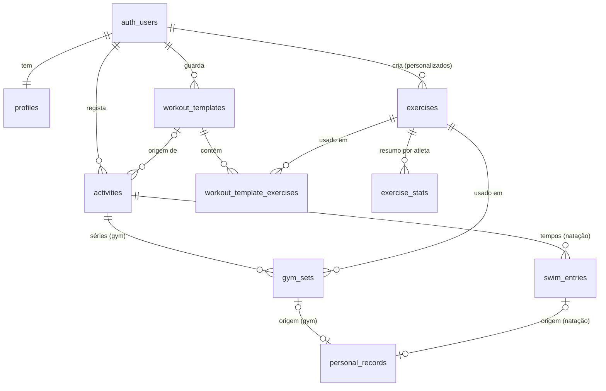

# Base de dados do Treker

Este documento explica como estão organizados os dados da v1 (Gym e Natação) e que regras os protegem. O código está em [`supabase/migrations/`](../supabase/migrations/) e os testes em [`supabase/tests/`](../supabase/tests/).

## Ideias de base

- **O Postgres é a última linha de defesa.** A app fala diretamente com o Supabase, por isso tudo o que a app verifica também é verificado na base de dados: quem pode ver o quê, a quem pertencem as referências e que valores são possíveis.
- **Preparada para funcionar offline.** Os ids (UUID) podem ser gerados no telemóvel. Assim, reenviar a mesma série durante a sincronização nunca a duplica: o id já existe.
- **Apagar é marcar.** Nas tabelas de dados, apagar significa preencher `deleted_at`. A linha continua lá para que os outros telemóveis do atleta saibam, na sincronização, que ela foi apagada. Só o servidor apaga linhas a sério (por exemplo, quando se apaga a conta).
- **Datas de treino são datas locais.** `local_date` é o dia do calendário do atleta, enviado pela app. Nunca se calcula a partir de UTC; um treino às 00:30 em Lisboa fica no dia certo.
- **Recordes e estatísticas são dados derivados.** Nunca são escritos pela app nem pelos utilizadores. São sempre reconstruídos a partir das séries e dos tempos, por isso editar ou apagar um registo antigo deixa tudo certo (ver [Recordes e estatísticas](#recordes-e-estatísticas)).

## Tabelas



### `profiles` — o perfil

Uma linha por utilizador, com o mesmo id da conta (`auth.users.id`). **É criada automaticamente quando a pessoa se regista**, por um trigger que lê o nome escolhido no registo.

| Coluna | O que guarda |
| --- | --- |
| `display_name` | Nome a mostrar (até 50 caracteres, opcional) |
| `weight_unit` | `kg` ou `lb` |
| `pool_unit` | `m` ou `yd` |
| `timezone` | Fuso horário IANA, por exemplo `Europe/Lisbon` |
| `locale` | Língua da app: `en` ou `pt` |
| `bodyweight_kg` | Peso corporal. **Privado**: nunca entra em vistas públicas |
| `visibility` | `private` por defeito |
| `onboarded_at` | Quando o atleta terminou o onboarding; vazio = a app mostra o onboarding (ver [auth.md](auth.md)) |
| `sports` | Modalidades que treina (`gym`, `swim`; lista sem repetidos e não vazia) |
| `gym_focus` | Foco no ginásio: `strength`, `hypertrophy` ou `maintenance` |
| `swim_style` | `competitive` ou `fitness` |
| `default_pool_length` | Piscina pré-selecionada ao registar um tempo (`25m`, `50m`, `25yd`) |
| `weekly_target` | Treinos por semana, de 1 a 14, todas as modalidades juntas |

Quando `onboarded_at` está preenchido, o Postgres exige as respostas completas (`profiles_onboarding_complete`): `sports` e `weekly_target` sempre, `gym_focus` se treina ginásio, e `swim_style` e `default_pool_length` se treina natação. O utilizador só altera estas colunas no próprio perfil (grants por coluna e RLS).

### `exercises` — exercícios

Duas famílias na mesma tabela:

- **Biblioteca partilhada** (`owner_id` vazio): 68 exercícios comuns, com `slug` (ex.: `barbell-bench-press`) e nomes em inglês e português. Vem numa migração ([`20261104140000_exercise_library.sql`](../supabase/migrations/20261104140000_exercise_library.sql)), por isso também existe em produção. Os ids são calculados a partir do slug e são iguais em todos os ambientes.
- **Personalizados** (`owner_id` = utilizador): criados pelo atleta. Guardam o nome nas duas colunas de nome e não têm slug.

| Coluna | O que guarda |
| --- | --- |
| `muscle_group` | Grupo muscular principal. É só uma etiqueta, não uma forma de navegar |
| `equipment` | Barra, halteres, máquina, polia, peso corporal, etc. |
| `tracks_load` | Se regista peso. Falso na prancha, por exemplo |
| `unit` | `reps` (repetições) ou `seconds` (segundos, como a prancha) |
| `adds_bodyweight` | Se o peso corporal conta como carga (elevações, dips) |
| `archived` | Escondido das listas, mas mantido no histórico (só a biblioteca usa; a app elimina os exercícios próprios com [`delete_custom_exercise`](#eliminar-um-exercício-próprio)) |

### `workout_templates` e `workout_template_exercises` — treinos guardados

Um treino guardado ("Push A") e a lista ordenada dos seus exercícios (`position`), com séries alvo (`target_sets`), intervalo de repetições alvo (`target_reps_min` a `target_reps_max`, ex.: 8 a 12) ou segundos alvo (`target_seconds`). Por agora a app grava um só alvo de repetições (`min = max`).

A app grava um treino e a sua lista **sempre de uma vez**, com a função [`save_workout_template`](#gravar-um-treino-guardado). Apagar um treino marca `deleted_at` só no treino; as linhas da lista ficam, mas nada as lê sem o treino.

### `activities` — treinos

Uma linha por treino, de qualquer modalidade. É a base do calendário, do perfil e da partilha.

| Coluna | O que guarda |
| --- | --- |
| `type` | `gym` ou `swim` |
| `local_date` | Dia do treino no calendário do atleta |
| `timezone` | Fuso onde o treino aconteceu |
| `started_at`, `ended_at` | Início e fim (opcionais; o fim nunca é antes do início). A sessão de ginásio da app não regista o fim (nem a duração): envia `ended_at` vazio |
| `title`, `notes` | Título e notas. As notas ficaram fora da v1: a app não as escreve e a coluna fica vazia, pronta para quando voltarem |
| `visibility` | `private` (por defeito), `followers` ou `public` |
| `template_id` | Treino guardado que deu origem a esta sessão (só gym) |
| `bodyweight_kg` | Peso corporal **nesse dia** (privado). Se a app não o enviar, é copiado do perfil quando a atividade é criada. Mudar o peso no perfil depois não altera atividades antigas |

### `gym_sets` — séries de ginásio

| Coluna | O que guarda |
| --- | --- |
| `exercise_position` | Ordem do exercício na sessão |
| `set_number` | Número da série dentro do exercício |
| `weight_kg` | Carga em kg (3 casas decimais para que valores em lb não se percam). Nos exercícios com peso corporal é o peso **adicionado**; negativo significa assistência (máquina de elevações assistidas) |
| `reps` ou `duration_s` | Repetições **ou** segundos, conforme a unidade do exercício. Nunca os dois |
| `difficulty` | Como correu a série: `easy`, `medium` ou `hard` (opcional). É o que a app regista; não mexe nos recordes |
| `rpe` | Esforço percebido de 1 a 10, em passos de 0,5 (opcional). A app deixou de o usar (substituído por `difficulty`); a coluna fica |
| `is_warmup` | Séries de aquecimento ficam fora do volume, 1RM e PRs. A sessão da v1 não tem aquecimentos, por isso a app envia sempre `false` |

### `swim_entries` — tempos de natação

| Coluna | O que guarda |
| --- | --- |
| `stroke` | `free`, `back`, `breast`, `fly` ou `im` |
| `distance` | Distância **na unidade da piscina**: metros em piscinas `25m`/`50m`, jardas em `25yd`. Tem de ser um número inteiro de piscinas |
| `pool_length` | `25m` (curta), `50m` (longa) ou `25yd`. Tempos de piscinas diferentes nunca se comparam |
| `time_cs` | Tempo em centésimos de segundo (27,61 s = `2761`) |
| `kind` | `race` (prova) ou `training` (treino) |
| `splits_cs` | Parciais em centésimos, por ordem (opcional) |
| `position` | Ordem dentro do treino |

### `personal_records` — histórico de recordes

Cada linha é um momento em que o melhor de sempre de uma **chave** melhorou:

| Modalidade | Chave | Valor | Melhor é |
| --- | --- | --- | --- |
| Gym | exercício | 1RM estimado em kg | maior |
| Natação | estilo + distância + tipo de piscina | tempo em centésimos | menor |

Cada linha guarda o valor, o melhor anterior (`previous_value`), a ordem dentro da chave (`sequence`: 1, 2, 3…), a `local_date`, a atividade e a série (`gym_set_id`) ou o tempo (`swim_entry_id`) que bateu o recorde. Na natação guarda também se foi prova ou treino (`swim_kind`).

A vista **`current_records`** mostra só o melhor atual de cada chave, ou seja, o último recorde do histórico.

### `exercise_stats` — resumo por exercício

Uma linha por atleta e exercício que tenha séries:

| Coluna | O que guarda |
| --- | --- |
| `best_one_rep_max_kg` | Melhor 1RM estimado (igual ao recorde atual) |
| `total_volume_kg` | Soma de peso × reps das séries de trabalho. A assistência (peso negativo) conta como zero |
| `set_count` | Número de séries de trabalho (sem aquecimentos) |
| `last_local_date` | Dia do último treino com este exercício |

### Colunas comuns

Todas as tabelas de dados do utilizador (não as derivadas) têm:

- `id`: UUID, que pode ser gerado no telemóvel.
- `user_id` (ou `owner_id` nos exercícios): o dono da linha.
- `created_at` e `updated_at`: **escritos pelo servidor**, nunca pela app. A sincronização usa o `updated_at` para saber o que mudou desde a última vez.
- `deleted_at`: preenchido quando a linha é apagada.

O `id` de uma linha nunca muda depois de criada.

## Regras de segurança

### Quem vê e altera o quê

| Tabela | Ler | Criar | Alterar | Apagar a sério |
| --- | --- | --- | --- | --- |
| `profiles` | Só o próprio | Ninguém (é o trigger do registo) | Só o próprio, e só as colunas editáveis | Ninguém |
| `exercises` (biblioteca) | Todos os utilizadores com sessão | Ninguém pela API | Ninguém pela API | Ninguém |
| `exercises` (personalizados) | Só o dono | Só para si próprio | Só o dono | Ninguém (usa `deleted_at`) |
| Restantes tabelas | Só o dono | Só para si próprio | Só o dono | Ninguém (usa `deleted_at`) |
| `personal_records`, `exercise_stats`, `current_records` | Só o dono | Ninguém (só o servidor) | Ninguém | Ninguém |

- **Visitantes sem sessão (chave `anon`) não leem nem escrevem nada.**
- Todas as tabelas têm RLS (Row Level Security) ativo, com uma política explícita para cada operação. Um teste falha se alguma tabela nova ficar sem RLS.
- Ninguém consegue passar as suas linhas para outro utilizador.

### As referências também são verificadas

Não basta a linha ter o `user_id` certo; aquilo para que ela aponta também tem de ser do mesmo utilizador:

- Uma **série** só pode pertencer a uma atividade do próprio utilizador, e essa atividade tem de ser de ginásio.
- Um **tempo de natação** só pode pertencer a uma atividade de natação do próprio utilizador.
- Uma série ou um treino guardado só podem usar exercícios **da biblioteca ou do próprio utilizador**.
- Uma atividade só pode vir de um treino guardado do próprio utilizador.

A posse da atividade e do treino guardado é garantida por chaves estrangeiras compostas, `(activity_id, user_id) → activities (id, user_id)`. A posse do exercício é garantida por um trigger. Por isso estas regras também valem dentro das funções do servidor, que ignoram o RLS.

### Valores impossíveis são recusados

Exemplos: repetições a zero ou negativas, RPE fora de 1 a 10 ou fora dos passos de 0,5, tempos de natação a zero, distâncias que não são um número inteiro de piscinas, parciais a zero, um treino que acaba antes de começar, fusos horários inexistentes, peso numa prancha, repetições num exercício medido em segundos, e peso negativo num exercício que não é de peso corporal.

### Funções internas

As funções dos triggers vivem no schema `private`, que não está exposto pela API. As funções `security definer` têm sempre o `search_path` fixo e não podem ser chamadas pelos utilizadores.

### Listar treinos com os totais

`public.list_activity_summaries(p_before_date date, p_before_started_at timestamptz, p_before_id uuid, p_limit int)` devolve uma página dos treinos do atleta (os do Perfil), os mais recentes primeiro, já com os totais de cada um. Os totais são calculados no Postgres, por isso a app nunca carrega as séries todas para os somar.

- **Paginação por cursor, nunca por offset.** A primeira página vai sem cursor. A seguinte passa o `(local_date, started_at, id)` da última linha recebida e recebe as linhas estritamente depois dela, pela ordem `local_date desc, started_at desc nulls last, id desc`.
  - Num mesmo dia, o treino que começou mais tarde vem primeiro; os treinos sem hora de início vêm no fim do dia. O `id` só desempata treinos com a mesma hora.
  - O `started_at` do cursor pode ser vazio (a última linha não tinha hora de início); a data e o id não.
  - Essa ordem é servida pelo índice `activities (user_id, local_date desc, started_at desc nulls last, id desc)`, que também serve o calendário.
  - Treinos acrescentados ou apagados entretanto nunca fazem uma página repetir ou saltar linhas.
- **No máximo 50 linhas por página**, bem abaixo do `max_rows` da API (a app pede 10).
- **Totais de cada treino:**

| Coluna | Ginásio | Natação |
| --- | --- | --- |
| `duration_s` | `ended_at − started_at` em segundos; vazio sem início e fim | igual |
| `set_count` | Séries de trabalho (sem aquecimentos) | Tempos registados |
| `volume_kg` | Soma de peso × reps das séries de trabalho; assistência (peso negativo) conta como zero | vazio |
| `distance_m` | vazio | Distância total em metros (piscinas em jardas convertidas, 1 jd = 0,9144 m) |

- Treinos, séries e tempos apagados ficam de fora. As regras são as mesmas das `exercise_stats` e de `src/core/activities`, que calcula os totais do ecrã de detalhe; os dois lados são testados com o mesmo exemplo.
- É `security invoker` (corre com o RLS do atleta), `stable`, com `search_path` vazio, e só `authenticated` a pode executar. Um cursor com só a data ou só o id dá erro (`22023`).
- Testes em `supabase/tests/17_activity_summaries.sql`:
  - os totais de ginásio e de natação;
  - os treinos apagados e os de outros utilizadores ficam de fora;
  - as páginas não repetem nem saltam linhas, mesmo com treinos novos entretanto;
  - dois treinos no mesmo dia pela hora de início, e os sem hora no fim do dia;
  - o limite de 50 linhas e o cursor incompleto;
  - o anónimo não pode chamar a função.

### Gravar uma sessão de ginásio

`public.save_gym_session(p_session jsonb)` grava um treino de ginásio terminado, chamada pela app por `rpc` num só pedido, quando o atleta carrega em "Gravar":

```json
{
  "id": "uuid da atividade", "local_date": "2026-11-05", "timezone": "Europe/Lisbon",
  "started_at": "…", "ended_at": null, "title": "Push A", "template_id": "uuid",
  "sets": [
    { "id": "uuid da série", "exercise_id": "uuid", "exercise_position": 0, "set_number": 1,
      "weight_kg": 100, "reps": 5, "duration_s": null, "difficulty": "easy", "is_warmup": false }
  ]
}
```

- **Numa só transação** cria a atividade (`gym`, com a data local e o fuso do atleta no início do treino) e todas as séries, com os ids gerados no telemóvel.
- A função ainda aceita `notes`, mas a app não o envia: as notas ficaram fora da v1.
- **Repetir o mesmo pedido não duplica nada:** a atividade e as séries entram com `on conflict do nothing` pelos ids, e a função devolve outra vez os mesmos recordes. É isto que torna seguro o "Tentar outra vez" depois de uma falha de rede, mesmo que o primeiro pedido tenha chegado ao servidor.
- **Os recordes são reconstruídos uma só vez por exercício.** As séries entram todas numa só instrução `insert`, e o trigger dos recordes corre uma vez por instrução. Por isso não é precisa a marca `treker.defer_record_rebuild` do `delete_activity`; o teste confirma 3 reconstruções para 3 exercícios, não 5 para 5 séries.
- **Devolve os recordes novos desta atividade** (linhas de `personal_records` com este `activity_id`), já depois da reconstrução. São os recordes "oficiais" que a app mostra no fim.
- **Ou grava tudo, ou nada:** um valor impossível (por exemplo 0 reps), um exercício próprio de outro utilizador ou um treino guardado de outro utilizador cancelam a chamada inteira.
- É `security invoker`, com `search_path` vazio, e só `authenticated` a pode executar. Um id de atividade que já é de outro utilizador dá erro (`42501`) e não é tocado.

### Última vez de cada exercício

`public.last_performance(p_exercise_ids uuid[])`: para cada exercício, as séries de trabalho da atividade mais recente (não apagada) em que o atleta o fez, com a data.

- "Mais recente" segue a mesma ordem da lista de treinos (`local_date`, depois `started_at`, depois `id`).
- Ficam de fora os aquecimentos, as séries e as atividades apagadas, e os dados dos outros utilizadores.
- Cada série vem com o peso, as reps (ou segundos) e a `difficulty`, para a app mostrar "Última vez: 10 kg · 5 reps · Fácil".
- `work_set_index` numera as séries de trabalho 1, 2, 3…, pela ordem em que foram feitas, para a app mostrar a série N ao lado da série N.
- `stable`, `security invoker`, só para `authenticated`.

Testes das duas funções em `supabase/tests/18_gym_session.sql`:
- grava a atividade e as séries de uma vez;
- repetir não duplica;
- uma falha a meio não deixa nada;
- não usa exercícios próprios de outro utilizador nem escreve na atividade de outro;
- os recordes certos, reconstruídos uma vez por exercício;
- devolve só os recordes desta atividade;
- o `last_performance` ignora aquecimentos, atividades apagadas e dados de outros utilizadores, e escolhe a sessão mais recente do dia;
- o anónimo não pode chamar nenhuma.

### Gravar um treino guardado

`public.save_workout_template(p_template jsonb)`, chamada pela app por `rpc` num só pedido:

```json
{
  "id": "uuid do treino",
  "name": "Push A",
  "notes": null,
  "exercises": [
    { "id": "uuid da linha", "exercise_id": "uuid", "target_sets": 4,
      "target_reps_min": 5, "target_reps_max": 5, "target_seconds": null, "notes": null }
  ]
}
```

- **Numa só transação**, faz upsert do treino pelo `id` e **substitui a lista**:
  - as linhas enviadas fazem upsert pelo seu `id`;
  - a `position` é a ordem no array (0, 1, 2…), não um valor enviado pela app;
  - as linhas do treino que não vêm na lista ficam marcadas com `deleted_at`, nunca removidas;
  - uma linha que volta à lista perde o `deleted_at`.
- **Os ids são gerados no telemóvel**, por isso repetir a mesma chamada ("Tentar outra vez" depois de uma falha de rede) não duplica nada.
- **Ou grava tudo, ou nada:** um alvo fora dos limites ou um exercício inválido cancelam a chamada inteira, e o nome e a lista anteriores ficam como estavam.
- É `security invoker`, com `search_path` vazio, e só `authenticated` a pode executar. Corre como o atleta, por isso valem o RLS, as chaves estrangeiras, os `check` e o trigger das referências:
  - não usa exercícios personalizados de outro utilizador (`23503`);
  - não escreve no treino nem nas linhas de outro utilizador (o upsert falha na política de update, `42501`);
  - uma linha do próprio atleta que pertence a outro dos seus treinos é recusada (`22023`), para nunca esvaziar outro treino em silêncio.
- Testes em `supabase/tests/15_save_workout_template.sql`:
  - grava um treino novo e substitui a lista;
  - repetir não duplica;
  - a ordem e os alvos ficam certos;
  - uma lista inválida não muda nada;
  - não usa exercícios próprios de outro utilizador;
  - não escreve no treino de outro utilizador;
  - o anónimo não pode chamar a função.

### Eliminar um exercício próprio

`public.delete_custom_exercise(p_exercise_id uuid)`, chamada pela app por `rpc` num só pedido:

- **Numa só transação**, marca `deleted_at` no exercício e nas suas linhas dos treinos guardados (`workout_template_exercises`). Sai da biblioteca e de todos os treinos guardados.
- **O histórico não muda:** as séries já registadas continuam a apontar para o exercício, por isso os treinos feitos, os recordes e as estatísticas ficam como estavam. A reconstrução dos recordes não olha para o `deleted_at` do exercício.
- **Repetir não tem efeitos:** um exercício já eliminado é ignorado.
- É `security invoker`, com `search_path` vazio, e só `authenticated` a pode executar. Um exercício da biblioteca ou de outro utilizador não é encontrado (`no_data_found`).
- Testes em `supabase/tests/16_delete_custom_exercise.sql`:
  - elimina o exercício e tira-o do treino guardado, mantendo os outros exercícios;
  - as séries, os recordes e as estatísticas mantêm-se;
  - repetir não muda nada;
  - não elimina exercícios da biblioteca nem de outro utilizador;
  - o anónimo não pode chamar a função.

### Apagar uma atividade

`public.delete_activity(p_activity_id uuid)`, chamada pela app por `rpc` num só pedido:

- **Numa só transação**, marca `deleted_at` na atividade, nas suas séries e nos seus tempos de natação, todos com a mesma hora. Ou fica tudo apagado, ou nada: uma falha de rede a meio nunca deixa uma atividade sem séries a contar no "Hoje".
- **Os recordes são reconstruídos uma só vez por chave.** Enquanto marca as séries e os tempos, a função liga a marca local à transação `treker.defer_record_rebuild`, e os triggers das séries e dos tempos não reconstroem. Depois marca a atividade, e o trigger da atividade reconstrói cada chave dos seus filhos uma vez. Os utilizadores não conseguem ligar essa marca por conta própria: a API só expõe funções do schema `public`, e cada pedido é uma transação.
- **Repetir não tem efeitos:** uma atividade já apagada é ignorada, por isso tentar outra vez depois de uma falha de rede é seguro.
- É `security invoker`, com `search_path` vazio, e só pode ser executada por `authenticated`. Corre como o próprio atleta, por isso o RLS aplica-se: a atividade de outro utilizador não é encontrada e a chamada dá erro (`no_data_found`).
- Testes em `supabase/tests/14_delete_activity.sql`:
  - apaga a atividade e os filhos de uma vez;
  - os recordes e as estatísticas ficam certos, com uma reconstrução por chave;
  - repetir não muda nada;
  - não apaga a atividade de outro utilizador;
  - o anónimo não pode chamar a função.

### Apagar conta

`public.delete_my_account()` também é chamada diretamente pela app (por `rpc`):

- É `security definer`, com `search_path` vazio e fixo.
- Só pode ser executada por `authenticated`; o anónimo não pode.
- Não recebe parâmetros: apaga **apenas** o utilizador de `auth.uid()`, e sem sessão dá erro.
- Apaga a linha de `auth.users`. Tudo o resto desaparece por cascata, na mesma transação: perfil, exercícios personalizados, treinos guardados, atividades, séries, tempos, recordes e estatísticas.
- A biblioteca partilhada e os dados dos outros utilizadores não são tocados (testes em `supabase/tests/13_delete_account.sql`).

Quando houver Storage (avatares, imagens), apagar a conta também tem de apagar os ficheiros da pasta do utilizador.

## Recordes e estatísticas

### 1RM (peso real ou fórmula de Epley)

```
1 rep:        1RM = peso                              (é um valor real, não uma estimativa)
2 a 12 reps:  1RM = (peso + pc) × (1 + reps / 30) − pc
```

`pc` é o peso corporal da atividade se o exercício tiver `adds_bodyweight`, senão é 0. Nas elevações e nos dips o 1RM fica em **peso adicionado**: 20 kg × 5 com 70 kg de peso corporal dá 35 kg, e uma elevação assistida pode dar um valor negativo. O resultado é arredondado a 0,01 kg, com as meias casas a afastarem-se do zero.

**Só conta** uma série que cumpra todas estas condições:
- não está apagada, e a atividade também não;
- não é aquecimento;
- o exercício tem `tracks_load` e `unit = reps`;
- tem entre 1 e 12 repetições (acima disso a fórmula deixa de ser fiável);
- tem peso, ou, nos exercícios com peso corporal, a atividade tem peso corporal.

A mesma fórmula existe na app em [`src/core/records`](../src/core/records/), para mostrar um recorde novo na hora, mesmo offline. As duas versões são testadas contra o mesmo ficheiro de casos, [`supabase/tests/fixtures/one-rep-max-cases.json`](../supabase/tests/fixtures/one-rep-max-cases.json), pelo Jest e pelo pgTAP. Se alguém mudar uma sem a outra, os testes falham.

### Natação

Contam todas as entradas não apagadas, de prova e de treino. Piscinas de 25 m, 50 m e 25 jardas nunca se misturam, nem os estilos.

### Como é reconstruído

- **Reconstruir uma chave** apaga os recordes dessa chave e percorre o histórico por ordem (`local_date`, `started_at`, ordem do exercício, `set_number`). Grava um recorde sempre que o melhor anterior é batido. No gym recalcula também as `exercise_stats`.
- **Triggers por instrução** em `gym_sets` e `swim_entries` juntam as chaves tocadas por cada insert, update ou delete e reconstroem cada chave **uma só vez por instrução**, mesmo que a instrução mexa em 50 séries. Alterações que não afetam recordes (como o RPE ou a dificuldade) não reconstroem nada.
- **Também reconstrói quando:**
  - uma atividade muda de `local_date`, `started_at` ou `bodyweight_kg`, ou é apagada (com `delete_activity`, uma só vez por chave, ver [Apagar uma atividade](#apagar-uma-atividade));
  - um exercício muda de `unit`, `tracks_load` ou `adds_bodyweight`.
- **Gravações em simultâneo:** cada reconstrução pede um bloqueio por utilizador (`pg_advisory_xact_lock`) que dura até ao fim da transação. Duas gravações do mesmo atleta ao mesmo tempo esperam uma pela outra, e a segunda já vê os dados da primeira. Por isso nunca há recordes duplicados.

Por isso, corrigir um tempo impossível (por exemplo 15,00 nos 50 m) faz reaparecer os recordes verdadeiros que vieram depois. E mudar o peso no perfil não reescreve recordes antigos, porque cada atividade guarda o peso do seu dia.

## Índices

| Para quê | Índice |
| --- | --- |
| Calendário e histórico, paginados por cursor (`list_activity_summaries`) | `activities (user_id, local_date desc, started_at desc nulls last, id desc)` |
| Última vez de cada exercício (`last_performance`) | `gym_sets (user_id, exercise_id)` |
| Recordes de um treino | `personal_records (activity_id)` |
| Séries de uma sessão | `gym_sets (activity_id)` |
| Histórico de um exercício | `gym_sets (user_id, exercise_id)` |
| Melhores tempos por prova | `swim_entries (user_id, stroke, distance, pool_length)` |
| Sincronização ("o que mudou desde...") | `(user_id, updated_at)` em todas as tabelas de dados |
| Reconstruir e mostrar recordes de uma chave | `personal_records (user_id, exercise_id, sequence)` e `(user_id, stroke, distance, pool_length, sequence)` |

## Comandos

```bash
npm run db:start   # arranca o Supabase local (precisa do Docker Desktop)
npm run db:reset   # recria a base de dados: migrações + seed
npm run db:test    # corre os testes pgTAP em supabase/tests
npm run db:types   # gera src/lib/supabase/database.types.ts
npm run db:stop    # para o Supabase local
```

O Studio local fica em http://127.0.0.1:54323.

## Ao acrescentar uma tabela

1. Uma migração nova em `supabase/migrations/` (`npx supabase migration new <nome>`).
2. Na mesma migração: RLS ativo, `revoke all` para `anon` e `authenticated`, só os `grant` necessários, e uma política por operação.
3. `id` uuid, `user_id`, `created_at`, `updated_at`, `deleted_at` e o trigger `private.set_timestamps`.
4. Chaves estrangeiras compostas `(…, user_id)` para referências a dados do utilizador.
5. Testes em `supabase/tests/` que provem que outro utilizador não lê, não altera e não apaga.
6. `npm run db:types` para atualizar os tipos da app.
7. As migrações acrescentam primeiro e só removem quando nenhuma versão antiga da app usa a coluna (as versões antigas ficam instaladas durante meses).

## Por fazer

- Os totais semanais.
- Quando houver muitos dados, medir com `explain` o custo da reconstrução de uma chave com histórico longo.
