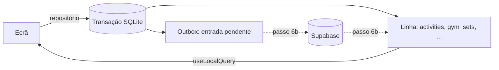

# Offline: base de dados local e fila de envio

A app grava e lê os dados de treino de uma base **SQLite no telemóvel**. Cada alteração fica também numa **fila de envio (outbox)**, na mesma transação, para ser enviada ao servidor. O envio e a receção de dados do servidor são o passo 6b; este documento descreve o que existe a partir do passo 6a.

## Escolha da camada de acesso

- **Drizzle ORM 0.45 (estável) com o driver `drizzle-orm/expo-sqlite`**, para o schema tipado e as consultas. Funciona no Expo Go com o SDK 58: o Drizzle é JavaScript puro e o `expo-sqlite` vem incluído no Expo Go. A documentação do Drizzle sugere `drizzle-orm@rc` com `expo-sqlite@next`, mas isso sairia da versão do expo-sqlite do SDK 58, por isso fica a versão estável.
- **Migrações próprias, numeradas**, em vez das do `drizzle-kit`. As do drizzle-kit precisam de configurar o Babel e o Metro para juntar ficheiros `.sql` à app, e de os transformar também no Jest. As nossas são SQL em TypeScript, numeradas com `PRAGMA user_version`.
- **Leituras reativas com um hook próprio** (`useLocalQuery`), assente no listener de alterações do expo-sqlite. O `useLiveQuery` do Drizzle só ouve a tabela principal da consulta: uma consulta a uma atividade e às suas séries não se atualizaria quando mudasse uma série.

## Schema local

Ficheiros em [`src/lib/local-db/`](../src/lib/local-db/).

- **Espelha o servidor:** os mesmos nomes de tabelas e colunas, os mesmos ids UUID e os mesmos valores dos enums. Os enums vêm diretamente das `Constants` geradas pelo Supabase (`src/lib/supabase/database.types.ts`).
- **Não diverge do servidor:** o [`schema-types.ts`](../src/lib/local-db/schema-types.ts) verifica, durante o `npm run typecheck`, que o tipo de cada linha local é **igual** ao tipo da linha no servidor. Se uma migração de um dos lados mudar uma coluna, o typecheck falha até os dois lados voltarem a bater certo.
- **Tipos do SQLite:** o SQLite não tem enums, booleanos, listas nem datas com fuso. Por isso:
  - os enums são texto, limitado aos valores do servidor;
  - os booleanos são inteiros 0/1;
  - as listas (`sports`, `splits_cs`) são texto JSON;
  - as datas e horas são texto ISO 8601.

| Tabela | Na app | Notas |
| --- | --- | --- |
| `profiles` | Lida e escrita | Uma linha, a do atleta. Como no servidor, não tem `deleted_at` (desaparece com a conta) |
| `exercises` | Os personalizados são escritos; a biblioteca é só leitura | A biblioteca (`owner_id` vazio) chega do servidor no 6b |
| `workout_templates`, `workout_template_exercises` | Lidas e escritas | |
| `activities`, `gym_sets`, `swim_entries` | Lidas e escritas | |
| `personal_records`, `exercise_stats` | Só leitura | Calculadas pelo Postgres; chegam do servidor no 6b |
| `outbox` | Interna | A fila de envio |

Todas as tabelas de dados do atleta têm `updated_at` e `deleted_at`, como no servidor.

### Migrações locais

[`migrations.ts`](../src/lib/local-db/migrations.ts):

- Cada migração tem uma versão e corre numa transação, juntamente com a atualização do `PRAGMA user_version`. Se falhar a meio, nada fica aplicado.
- **Nunca se edita uma migração já publicada**; acrescenta-se uma nova com a versão seguinte. Primeiro acrescenta-se, e só se remove quando nenhuma versão antiga da app precisar.
- Hoje há duas: a **v1** cria as tabelas e a outbox, e a **v2** acrescenta os índices das leituras mais frequentes. A v2 existe também para o caminho de atualização ficar testado desde já.
- Os testes confirmam que:
  - uma base nova chega à última versão;
  - as tabelas criadas são iguais ao schema do Drizzle;
  - uma base na v1 com dados passa para a v2 sem perder nada;
  - uma migração que falha a meio não deixa nada aplicado.

### Uma base por utilizador

O ficheiro chama-se `treker-<id do utilizador>.db`, por isso duas contas no mesmo telemóvel nunca se misturam.

- **Terminar sessão** não apaga o ficheiro: na próxima entrada, os dados (incluindo alterações ainda por enviar) continuam lá.
- **Apagar a conta** apaga o ficheiro.

A base abre com `journal_mode = WAL` e `foreign_keys = on`.

## Regras de escrita

Os ecrãs **nunca** escrevem SQL nem chamam o Supabase para dados de treino. Usam os repositórios:

| Repositório | Operações |
| --- | --- |
| [`features/activities/repository.ts`](../src/features/activities/repository.ts) | Começar, terminar, editar e apagar uma atividade; ler uma atividade com as séries e os tempos; listar e contar atividades por intervalo de datas |
| [`features/gym/repository.ts`](../src/features/gym/repository.ts) | Acrescentar, editar, apagar e listar séries |
| [`features/swim/repository.ts`](../src/features/swim/repository.ts) | Acrescentar, editar e apagar tempos de natação |
| [`features/exercises/repository.ts`](../src/features/exercises/repository.ts) | Criar e procurar exercícios personalizados |
| [`features/profile/repository.ts`](../src/features/profile/repository.ts) | Ler e editar o perfil; concluir o onboarding; guardar a cópia do servidor |

Todos seguem as mesmas regras ([`write.ts`](../src/lib/local-db/write.ts)):

1. **A linha e a entrada da outbox são escritas na mesma transação**: ficam as duas, ou nenhuma.
2. **A outbox guarda a linha tal como ficou** depois da escrita, com os nomes de colunas do servidor, pronta a enviar.
3. **Apagar é sempre marcar `deleted_at`**, e vai para a outbox como operação `delete`. Apagar uma atividade apaga também as suas séries e tempos.
4. **`updated_at` é atualizado em cada escrita.** O servidor põe o seu próprio quando a alteração lá chegar.
5. **Uma atividade copia o peso corporal do perfil** quando não é indicado, como o trigger do servidor.

## Outbox

Tabela `outbox`: `id`, `table_name`, `row_id`, `operation` (`upsert` ou `delete`), `payload` (a linha em JSON), `priority`, `created_at`, `attempts`, `last_error` e `status` (`pending`, `sending` ou `failed`).

- **Uma só entrada por linha à espera.** Várias alterações à mesma linha antes do envio ficam numa só entrada, com a operação e os dados mais recentes, por isso nunca se enviam estados intermédios. A entrada mantém a sua posição na fila.
  - Uma entrada **já a ser enviada** (`sending`) não é tocada: uma alteração feita entretanto ganha uma entrada nova.
  - Uma entrada que **falhou** (`failed`) é substituída pela alteração seguinte e volta a `pending`, com as tentativas a zero.
  - Isto é garantido por um índice único parcial, `(table_name, row_id) where status in ('pending', 'failed')`.
- **Ordem de envio pelas dependências:** cada tabela tem uma prioridade (perfil, exercícios, treinos guardados, exercícios dos treinos guardados, atividades, e por fim séries e tempos), e dentro da mesma prioridade vai primeiro o mais antigo. Assim, uma atividade e um exercício personalizado vão sempre antes das séries que os usam, mesmo que tenham sido editados depois.

## Leituras reativas

`useLocalQuery(store, read, tables, deps)` ([`use-local-query.ts`](../src/lib/local-db/use-local-query.ts)) lê da base local e volta a ler sempre que muda uma das tabelas indicadas (listener de alterações do expo-sqlite, `enableChangeListener`).

Exemplos:
- o perfil, no `AuthProvider`;
- a contagem semanal do "Hoje" e do menu ([`use-workouts-this-week.ts`](../src/features/activities/use-workouts-this-week.ts)): atividades não apagadas com `local_date` na semana atual, de segunda a domingo, na data local do telemóvel.

## O perfil

- **No login**, o perfil é descarregado uma vez do servidor para a base local. Não é descarregado se houver alterações ao perfil ainda por enviar, para não as perder; se não houver rede, fica-se com a cópia local.
- **A app lê sempre o perfil da base local.**
- **Concluir o onboarding e editar o perfil** gravam na base local e na outbox. Funcionam sem rede.

## Até ao passo 6b

Nada é enviado nem recebido do servidor além do perfil no login. Na prática:

- As alterações ao perfil, incluindo concluir o onboarding, **ficam só neste telemóvel**. Noutro telemóvel, ou depois de apagar a base local, o servidor ainda tem o perfil antigo (por exemplo, sem onboarding).
- As atividades, séries e tempos ficam na outbox à espera.
- A biblioteca de exercícios, os recordes e as estatísticas ainda não chegam ao telemóvel.

## O que fica para o 6b

- **Enviar a outbox** por ordem, em lotes, de forma idempotente (os ids vêm do telemóvel), com tentativas e registo de erros (`attempts`, `last_error`, `failed`).
- **Receber do servidor** o que mudou desde a última vez, pelo `updated_at`: as linhas do atleta, a biblioteca de exercícios, os recordes e as estatísticas.
- **Conflitos:** decidir pelo `updated_at` e nunca sobrepor alterações locais ainda por enviar.
- **Apagar no servidor:** um `delete` de uma linha que o servidor nunca recebeu (criada e apagada offline) também tem de ser enviado, como linha com `deleted_at`.
- **Saber quando enviar:** ao voltar a ter rede e ao abrir a app.

## Desenvolvimento

O ecrã **"Base local"** (só em desenvolvimento, `/dev/local-db`) mostra:
- o número de linhas de cada tabela;
- as entradas da outbox à espera.

E tem dois botões:
- **"Create test workout (3 sets)"** cria um treino de hoje com 3 séries de um exercício personalizado de teste;
- **"Delete local database"** apaga a base e volta a descarregar o perfil do servidor. Perde as alterações ainda não enviadas.

## Testes

Nos testes Jest, o `expo-sqlite` é substituído por [`test-utils/expo-sqlite-mock.ts`](../test-utils/expo-sqlite-mock.ts), que usa o SQLite do Node (`node:sqlite`). Por isso o Drizzle, as migrações e os repositórios correm a sério, contra um SQLite verdadeiro.

- [`src/lib/local-db/migrations.test.ts`](../src/lib/local-db/migrations.test.ts): versões, schema igual ao do Drizzle, atualização sem perder dados, falha a meio.
- [`src/lib/local-db/write-rules.test.ts`](../src/lib/local-db/write-rules.test.ts):
  - escrita e outbox atómicas (nos dois sentidos);
  - uma só entrada por linha;
  - entradas a ser enviadas ou que falharam;
  - apagar (incluindo em cascata);
  - ordem de envio;
  - leituras;
  - perfil do servidor;
  - duas contas no mesmo telemóvel.
- [`__tests__/app/today-test.tsx`](../__tests__/app/today-test.tsx): a contagem semanal do "Hoje" (incluindo a atualização automática) e o ecrã "Base local".
- [`src/core/dates`](../src/core/dates/): data local num fuso horário e semana de segunda a domingo.
